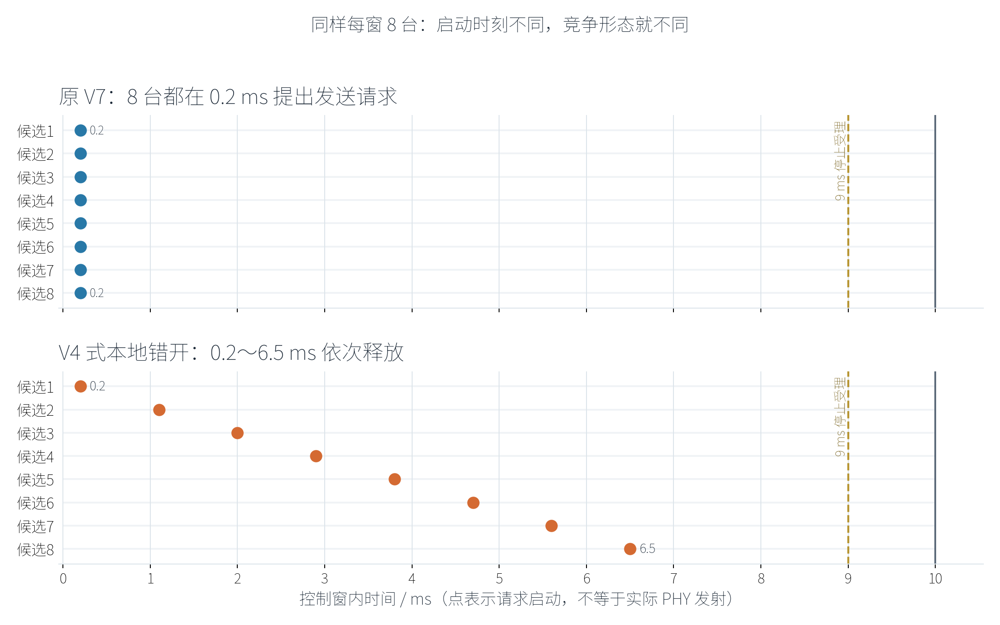
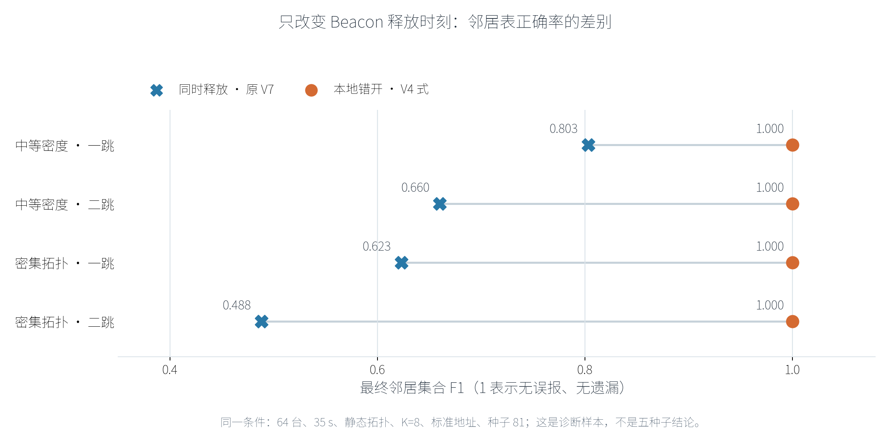

# V7 Beacon 控制窗竞争问题：为什么 10 ms 装得下 8 帧，却维护不准拓扑

**阶段性质：**调度问题诊断；数据为 64 台、单一种子（81）的对照，不是 V7 五种子正式结论。

## 1. 核心结论

问题**不是** 10 ms 控制窗或物理速率不足。当前参数下，Beacon 的单次 PHY 空口时间约 0.2 ms；8 次顺次发射的纯空口时间约 1.6 ms，尚未计入退避、队列和保护间隔。真正改变结果的是 **8 台电台何时开始竞争**：V4 曾将它们错开到 0.2、1.1、2.0……6.5 ms；V5 沿用至原 V7 的分布式候选算法，却让所有入选电台都在 0.2 ms 提出发送请求。后者在高连接度拓扑中降低了有效 Beacon 接收，进而造成邻居表遗漏。这里的“提出发送请求”不等于实际 PHY 发射，也不等于邻居接收成功。

## 2. 两种发送方式到底有什么不同

图1 的每个圆点代表一台电台向 MAC 提交 Beacon 请求的时刻，**不是实际占用空口的时刻**。两种方式都仍由电台本地计算候选资格，底层仍运行 802.11n 的载波侦听与退避；差别仅在候选进入竞争的时刻。原 V7 把 8 台的请求压在同一瞬间，V4 式做法把请求分散在 10 ms 内。9 ms 处关闭控制队列，10 ms 处结束控制窗。

“分布式”不必等于“同时抢发”：只要各电台共享成员版本和超帧号，便可以分别在本地算出是否入选及本窗的释放次序，不需要中心电台下发名单。与此同时，这种错开释放仍以足够一致的时间基准为前提；同步与成员不一致是后续必须测试的边界。

## 3. 相同条件下的诊断证据

控制条件：64 台、8×8 固定网格、35 s、静态拓扑、每窗 8 个候选、标准 Beacon 与标准 Data 地址、同一种子 81；中等和密集拓扑仅改变可通信范围。下图只改 Beacon 释放时刻，其余条件相同。

| 拓扑 | 释放方式 | 一跳 F1 | 二跳 F1 | 两表全对电台 | 成功收到的 Beacon 副本 |
|---|---|---:|---:|---:|---:|
| 中等密度 | 0.2 ms 同时释放 | 0.803 | 0.660 | 1/64 | 11,809 |
| 中等密度 | 0.2～6.5 ms 错开 | 1.000 | 1.000 | 64/64 | 18,375 |
| 密集拓扑 | 0.2 ms 同时释放 | 0.623 | 0.488 | 0/64 | 10,950 |
| 密集拓扑 | 0.2～6.5 ms 错开 | 1.000 | 1.000 | 64/64 | 26,775 |

每组控制发送请求都是 2,800 次，即 350 个控制窗×8 个候选。接收副本数随错开发送显著增加；例如密集拓扑从每次请求平均约 3.91 个邻居成功接收，提升到约 9.56 个。这说明**瓶颈是有效接收，不是名义帧数算术**。再将候选数降到每窗 1 台时，中等和密集的静态拓扑也能两表全对；增加到 2 台就出现错误，支持同窗竞争导致损失的判断。不过仅凭这些汇总量，还不能精确分摊为碰撞、隐藏终端或排队各占多少。

作为补充，35 s 动态拓扑、同一种子 81、K=8 且错开释放时，中等和密集场景的最终一跳 F1、二跳 F1、两表全对节点比例也均为 1。但这仍只证明**最终状态**，不能替代各节点生命期正确率、事件后恢复时延和更多随机种子的统计。

## 4. V7 已做修正与接下来的验证

V7 增加可选的控制窗释放方式：`simultaneous` 保留原结果可复现，`staggered` 由每台电台在本地算出 0.9 ms 间隔的释放次序，`jitter` 预留随机抖动对照。正式的密度×地址实验统一采用 `staggered`，四种组合分别是标准/标准、短 Beacon/标准 Data、标准 Beacon/短 Data、两者都短；每一组使用相同种子及相同业务请求，并核对控制窗越界计数。

后续正式矩阵已按用户要求缩量：稀疏拓扑保留已完成的五种子结果；中等和密集拓扑各取三个种子，每个种子做四种地址组合，即每种密度 12 组。包长与控制帧丢失实验暂缓，待此轮汇报后决定。**旧版“同时释放”的低正确率只能用于调度诊断，不能被算作短地址的收益；本小汇报也不提前宣称错开释放在所有种子、真实无线信道或未来 128/256 台网络中都成立。**

**给老师的一句话：**10 ms 中发送 8 个 Beacon 在空口时间上有余量，但让 8 台在同一时刻进入 CSMA/CA 会在复杂拓扑里损失大量邻居接收；分布式选择候选与在窗口内错开发起并不矛盾，后者已在单种子对照中恢复了拓扑正确性，正式多种子验证仍在继续。
