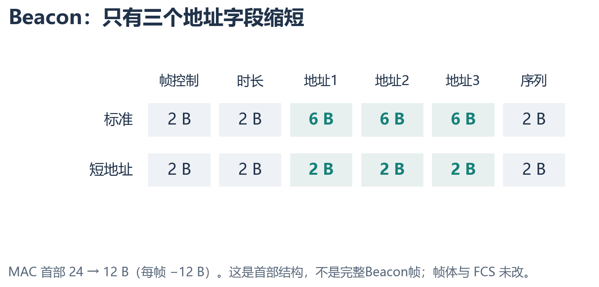
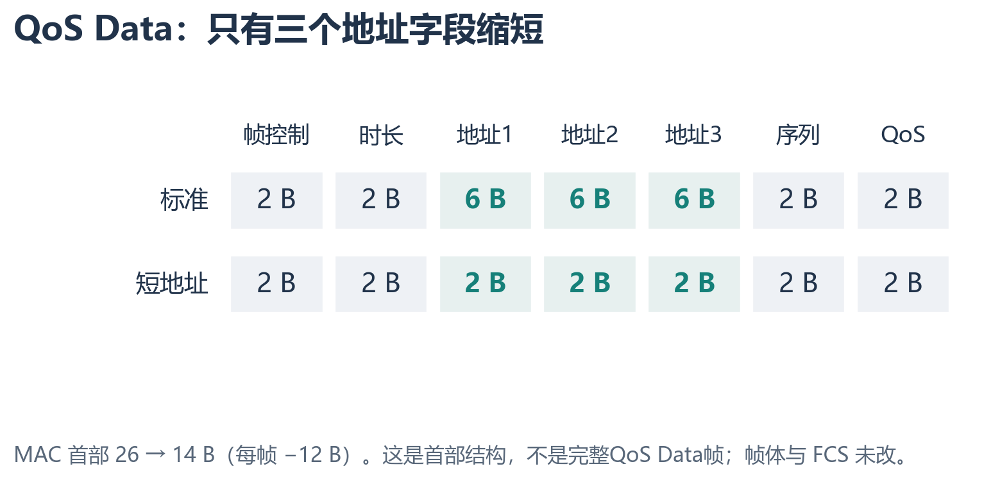
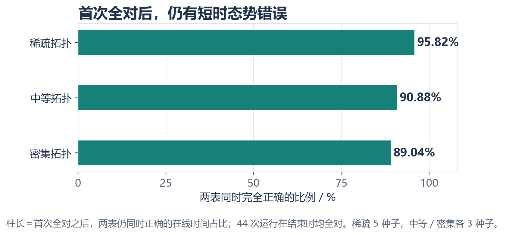
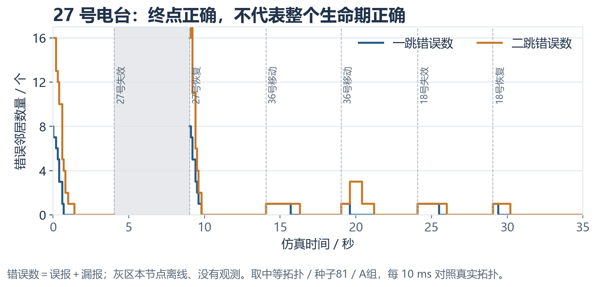
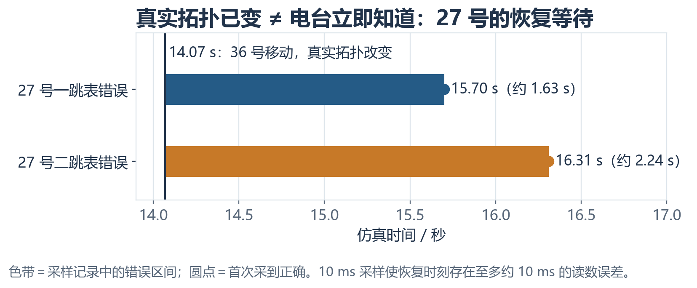
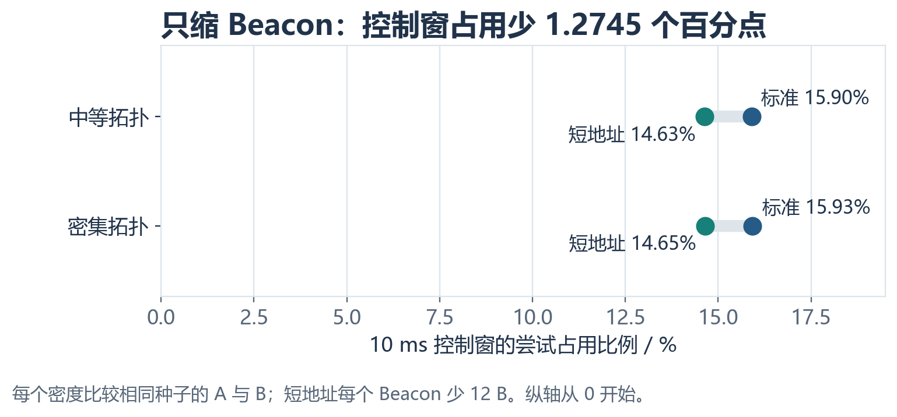
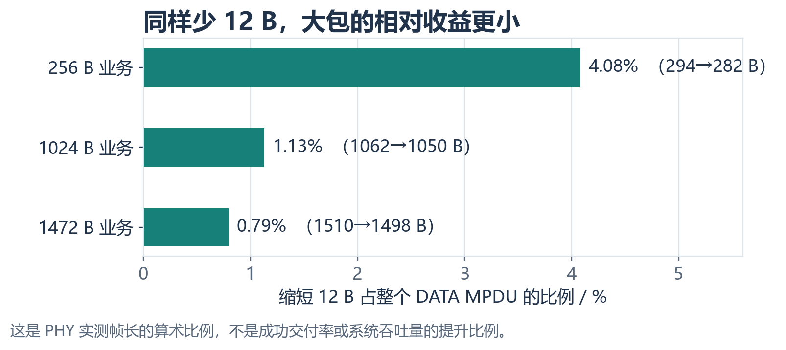
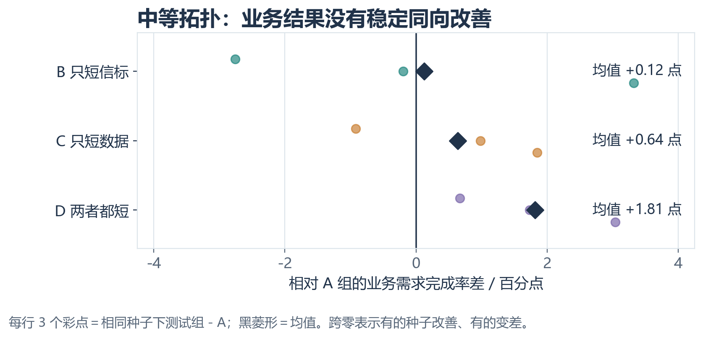
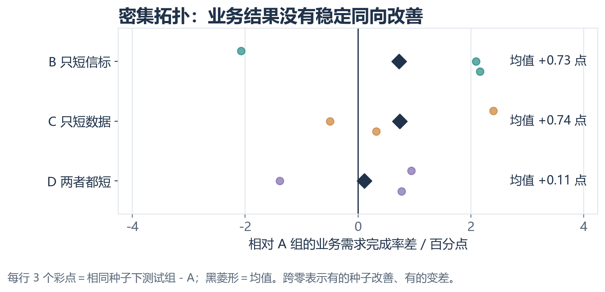

# V7 短地址与拓扑密度实验：清晰版汇报

**日期：**2026 年 10 月 9 日。**范围：**64 台已入网、已同步电台；本版是地址字段缩短的阶段性验证，不是完整实物协议。

## 一、先回答三个问题

| 问题 | 已有证据 | 不能推出 |
|---|---|---|
| 短 Beacon 会破坏态势维护吗？ | 44 次运行结束时一跳、二跳表均完全正确；同种子四组的生命期正确率近乎重合。 | 不能说运行全程正确，也不能外推到所有链路条件。 |
| 控制资源省了吗？ | 每个短 Beacon 少 12 B；中等与密集拓扑均少 44.608 ms 累计控制发送空口时间，约 8.0%。 | 不是整网吞吐提高 8.0%。 |
| 短 Data 让业务更好吗？ | 每个 QoS Data MPDU 少 12 B；配对种子的业务完成率有升有降。 | 目前不能证明稳定净收益，且短编号映射成本未计入。 |

**核心结论：**短 Beacon 的控制开销收益已得到实测支持；短 Data 的单帧长度收益已得到实测支持；业务净收益还没有得到证明。

## 二、比较条件与四种方案

| 组别 | Beacon 地址 | QoS Data 地址 | 用途 |
|---|---|---|---|
| A | 6 B 标准地址 | 6 B 标准地址 | 基准 |
| B | 2 B 实验短地址 | 6 B 标准地址 | 只看 Beacon 缩短 |
| C | 6 B 标准地址 | 2 B 实验短地址 | 只看 Data 缩短 |
| D | 2 B 实验短地址 | 2 B 实验短地址 | 两者共同缩短 |

每超帧 100 ms，其中控制窗 10 ms、数据窗 90 ms。每台电台依据本地规则独立计算是否成为本窗 Beacon 候选，目标每窗 8 台；候选请求错开释放，真正发送仍经 802.11n CSMA/CA 竞争。这不是中央节点逐台下令，也未证明 K＝8 在其他规模下最优。64 台节点固定在 8×8 网格；用 36／46／65 m 通信范围改变稀疏／中等／密集连通度，**节点数始终是 64**。业务为 256／1024／1472 B 混合包长、每节点标称 0.25 Mb/s；35 s 中有六次脚本拓扑事件。

稀疏保留 5 个种子×4 模式＝20 组；中等、密集各 3 个种子×4 模式＝12 组，合计 **44 次运行**。同一密度和种子的 A/B/C/D 具有逐条相同的业务需求与拓扑事件。**每 10 ms 对照**是仿真实验的观察频率，并不是电台每 10 ms 更新邻居表；邻居表在收到 Beacon 或超时老化时才改变。中等、密集的 24 组均通过业务配对检查，控制／数据越窗为零，每组有 64 台节点生命期记录，运行日志无失败。

## 三、帧结构：真正缩短的是三个地址字段

图 1 **只画 MAC 首部**。帧控制指出帧类型；时长用于介质预约；地址 1 在本场景为广播接收地址，地址 2 为发送电台，地址 3 为网络标识；序列字段用于编号与去重。标准首部 24 B，实验短首部 12 B，即三个地址各少 4 B、每帧共少 **12 B**。Beacon 的时间戳、间隔、能力及信息元素等帧体字段和 FCS 均未因本地址实验而缩短。

图 2 的 QoS 控制字段仍为 2 B，数据载荷、FCS 和 ACK／RTS／CTS 也不变，因此标准／短地址首部为 26／14 B，同样每帧少 12 B。图中 2 B 地址属于**专用实验格式**，未经修改的标准 802.11n 电台不能被默认认为可以直接解析。本仿真预先静态配置短编号与 MAC 地址映射，尚未模拟编号分配、冲突和映射过期。

## 四、态势维护：终点正确，不等于“节点一生”正确

图 3 只画 A 组，避免 A/B/C/D 基本重合造成遮挡。指标计算方法：对每台电台，从一跳、二跳表**第一次同时完全正确**起，统计其在线期间两表仍同时全对的时间比例，再对节点和种子取平均。稀疏 **95.82%**、中等 **90.88%**、密集 **89.04%**。虽然全部 44 次运行在结束时的 F1 和两表全对节点比例均为 **1.000**，运行过程中确实会短时出错。密度增大伴随正确时间比例下降，但本轮不能单独认定是碰撞或字段长度导致。

图 4 取中等拓扑、种子 81、A 组的 27 号电台。纵轴为一跳／二跳邻居表各自的**误报＋漏报数**，0 才表示该层表与真实拓扑一致。启动后逐渐学全；4.05～9.03 s 本节点失效，灰区没有有效观测，**不能视作零错误**；恢复后需重新学习。36 号、18 号节点的后续移动或失效／恢复又造成短时错误。此图是可核对的单节点例子，不替代 64 台节点统计。

### 补充验证：真实变化发生后，电台为何会有一段“不知道”的时间

图 5 把图 4 中的一次事件展开。**14.07 s**，36 号移动，真实拓扑立即改变；27 号却不会收到“真实拓扑已变”的通知。其表中仍保留旧关系：14.07 s 的记录显示一跳误报 36 号，二跳误报 45 号。一跳表在 **15.70 s** 首次采到完全正确，约晚 **1.63 s**；二跳表在 **16.31 s** 首次采到完全正确，约晚 **2.24 s**。在 15.70 s，一跳虽然已正确，二跳仍误把 36 号当成二跳邻居。这说明二跳态势恢复可能比一跳更慢。上述恢复时刻来自 10 ms 样本，精度约为一个采样周期，**不能说精确到 0.01 s 的真实处理瞬间**。

| 层次 | 变化发生时刻 | 电台首次采样正确时刻 | 这段时间代表什么 |
|---|---:|---:|---|
| 真实拓扑 | 14.07 s | 不适用 | 仿真实验知道位置变化；电台算法不知道。 |
| 27 号一跳表 | 14.07 s 后错误 | 15.70 s | 旧邻居尚未被排除，是一跳态势滞后。 |
| 27 号二跳表 | 14.07 s 后错误 | 16.31 s | 二跳信息还要依赖邻居通告与本地重算。 |

**为什么不是 10 ms 发现故障？**10 ms 对照只负责“量测正确与否”。本实验每台节点大致轮到每 8 个 100 ms 超帧发送一次 Beacon；接收方一收到 Beacon 就更新自己的表，**不必等全网八窗结束再统一更新**；长时间收不到时，程序以距上次收到的时长计算错过轮次，两轮后标为“可疑”并不再参与有效邻居计算，三轮后标为“失效”。老化检查在每个超帧末进行。因此真实变化与邻居表纠正之间本来就存在等待，恰恰应纳入态势维护的**检测时延、错误持续时间与事件后稳定正确时间**，不应把它解释为程序必然出错。

**节点故障不是主动退网。**本版的“失效”事件把故障电台的 PHY 关闭并停止其 Beacon；仿真真实拓扑立即把它视为离线，但其他电台不会得到一条神奇的全网退网通知。它们仍保留旧表项，直到错过预期 Beacon 并触发老化。反过来，仅凭没收到 Beacon 也不能在真实无线网络中断定对方硬件故障：碰撞、遮挡、移动出覆盖区都可能造成同样现象。因此本版评价的是“发现邻接关系已不可靠并修正表”的能力，而不是准确诊断故障原因。

**10 ms 观察会漏掉什么？**只看周期采样图，持续不足 10 ms 的“错误→恢复”可能落在两次采样之间；图 5 的首次正确时间也只有约 10 ms 分辨率。当前代码还在真实拓扑事件、Beacon 接收和邻居老化导致状态变化时写入节点生命期状态转换，因此主要已建模变化并非仅靠周期采样发现。但这仍依赖这些事件钩子覆盖所有相关状态变化，不能声称观察绝对无盲区。更严格的下一步是直接用逐节点状态转换日志计算事件发生、首次察觉、首次正确、稳定正确的仿真事件时间，并与 10 ms 曲线交叉核对。

**本页证据的范围：**图 3 是 64 台节点正确时间比例的汇总，图 4 和图 5 是 27 号电台的可核对样例；本页尚未展示完整的“64 台×35 s”节点时间矩阵。逐组原始 `node-topology-metrics.csv`、`node-lifetime-transitions.csv` 保存在虚拟机结果目录；本地当前只有汇总和 27 号样例，不能从均值反造完整矩阵。汇报时应明确这一点。

## 五、短 Beacon：控制开销确实下降

图 6 只比较同密度、同种子的 A（标准 Beacon）与 B（短 Beacon）。中等拓扑控制窗尝试占用率 **15.9041%→14.6296%**；密集拓扑 **15.9258%→14.6513%**，均减少 **1.2745 个百分点**。分母是控制窗总时间，不是整个 100 ms 超帧。

35 s 累计控制发送空口时间，中等为 **556.644→512.036 ms**，密集为 **557.404→512.796 ms**，均减少 **44.608 ms**，相对原值约 8.0%。PHY 发射记录中，标准 Beacon MPDU 为 122～130 B，短 Beacon 为 110～118 B；以中等种子 81 的 2,788 次发射为例，每次约少 16 µs，累计即 44.608 ms。这个“8.0%”**仅指控制发送空口时间的相对下降**，不是业务窗延长或整网吞吐提升。

## 六、短 Data：帧长节省与业务结果必须分开

PHY 实测无聚合 Data MPDU：256 B 业务包为 **294→282 B**（少 4.08%）；1024 B 为 **1062→1050 B**（少 1.13%）；1472 B 为 **1510→1498 B**（少 0.79%）。小包的相对帧长收益更大，但这些百分比都不是业务成功率的提升。

图 8 每行三个彩点代表种子 81／82／83 的“测试组－A 组”业务需求完成率差，黑菱形是三种子均值；零线左侧变差，右侧改善。中等拓扑 B／C／D 均值为 **＋0.12／＋0.64／＋1.81 个百分点**，但并非每个种子都改善。

密集拓扑 B／C／D 均值为 **＋0.73／＋0.74／＋0.11 个百分点**；D 已接近零，个别种子下降。A→D 的三种子配对差，中等拓扑 95% t 区间约 **＋1.815 ± 2.947 个百分点**，密集约 **＋0.110 ± 3.228 个百分点**，均跨零。因此不能宣称业务收益稳定为正。完成率的分子是接收端**实际收到的包**，不是发送端成功出队。每交付 KiB 所需的数据空口时间也未呈跨种子稳定改善；竞争、退避和重传会改变净结果。

## 七、存在的问题和下一步

1. **样本数有限。**中等、密集各仅三个配对种子。下一步先增加种子，并按 256／1024／1472 B 分层看短 Data 净效率，避免混合包长平均值掩盖差异。
2. **短编号管理尚未计价。**实物自组织电台还需入网编号、冲突消解、离网／重入网、网络合并后的映射更新。应设计这套过程，比较节省的帧字节与新增管理开销的净差。
3. **密度不等于规模。**本轮始终 64 台；K＝8 不是 128／256 台的结论。需测节点规模与 K 变化对 10 ms 控制窗容量、碰撞、态势及时性的影响。
4. **信道简化。**未测非对称链路、真实 SNR／衰落和动态丢包。后续应在链路劣化时复测生命期正确率与事件恢复时间。
5. **标准互通未解决。**短地址改变 MAC 首部。若要求与现有 802.11n 实物电台互传，应比较“标准帧体承载短编号”和“双方修改 MAC 解析”两条路线，而非宣称当前格式天然兼容。

**给老师汇报的收束：**“我把 Beacon 评价拆成态势正确性和资源代价。V7 的 44 次运行最终邻居表均正确，但节点生命史表明过程中有短时错误。实验短地址使 Beacon 和 Data 各少 12 B；Beacon 控制发送空口时间约少 8%。然而业务完成率尚无稳定改善，短编号管理代价也没计入。下一阶段重点是证明动态映射后的净收益，并扩展链路条件与节点规模。”
