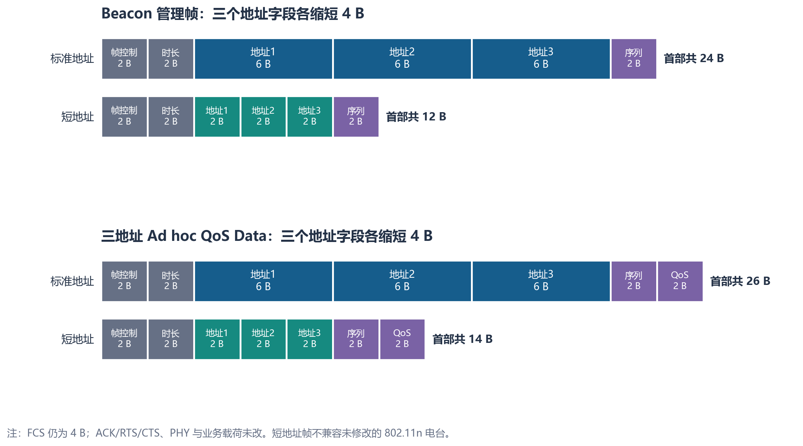
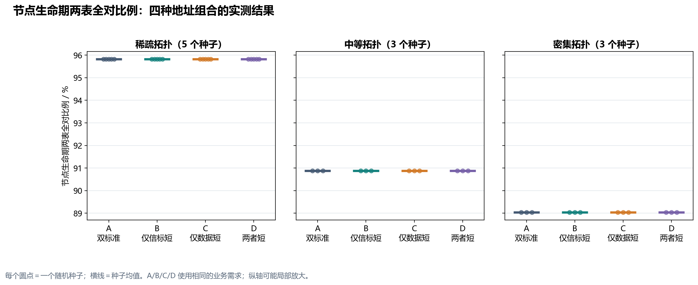
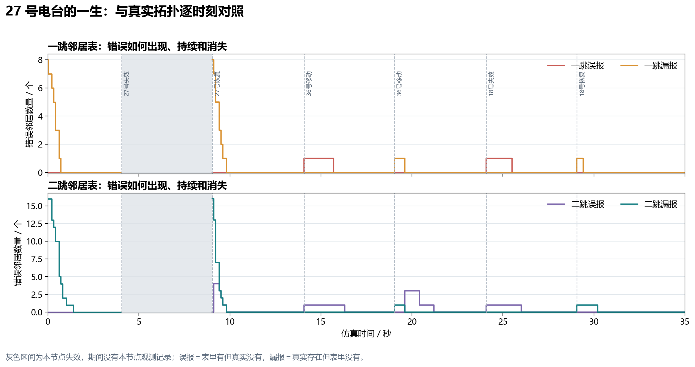
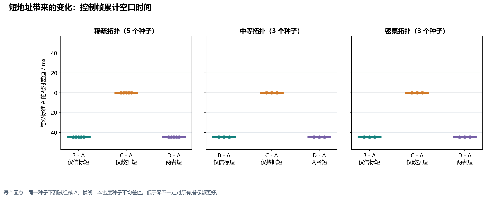
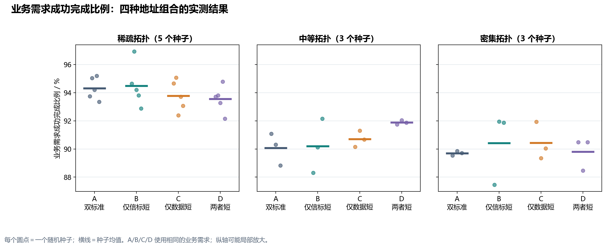
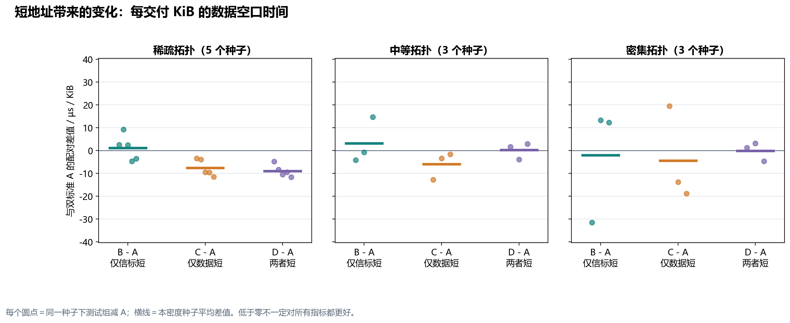

# V7 短地址与拓扑密度实验：阶段汇报

**时间：**2026 年 10 月 8 日。**性质：**64 台电台、三种拓扑密度下的短地址对照实验；这是阶段性验证，不是完整实物协议或 128/256 台容量结论。

## 一、先给结论

在本轮统一采用的分布式候选、错开释放和 802.11n CSMA/CA 条件下，稀疏、中等和密集拓扑的 **44 次运行在结束时一跳、二跳邻居表均完全正确**。但“结束时全对”不能代表运行全程正确：剔除各节点首次两表全对之前的冷启动时段，A 方案的节点生命期两表全对时间比例均值分别为 **95.82%、90.88%、89.04%**。因此，Beacon 评价必须同时看最终正确性和动态变化后的恢复过程。

把 Beacon 的三个 6 B 地址改成 2 B，实测每个 Beacon MPDU 固定少 **12 B**。中等、密集拓扑的 35 s 运行中，短 Beacon 使控制帧累计发送空口时间都减少 **44.608 ms**，约为原值的 **8.0%**；控制窗尝试占用率下降 **1.2745 个百分点**。这只是控制发送资源的收益，不能说整网吞吐量提高了 8%。

短 Data 同样使每个三地址 QoS Data MPDU 少 **12 B**，但业务成功完成比例和“每交付 KiB 所需空口时间”没有跨密度、跨种子稳定同向改善。三种子配对区间很宽，现阶段不能宣称短地址一定提高吞吐或交付率。短编号分配、冲突处理和映射维护尚未模拟，以上属于**地址字段缩短的毛收益**。

## 二、比较的是什么

图 1 只画 MAC 首部。A 是标准 802.11n 的 6 B 地址；B/C/D 是专用实验格式的 2 B 地址，并非未经修改的 802.11n 电台可直接接收的标准帧。帧控制、时长、序列控制、QoS 控制、FCS、ACK/RTS/CTS、PHY 和业务载荷不随短地址变化。实验中使用预入网静态编号映射，不能把它误认为已实现动态入网和分布式编号管理。

| 组别 | Beacon 地址 | QoS Data 地址 | 目的 |
|---|---|---|---|
| A | 6 B 标准地址 | 6 B 标准地址 | 基准 |
| B | 2 B 短地址 | 6 B 标准地址 | 单独考察 Beacon 缩短 |
| C | 6 B 标准地址 | 2 B 短地址 | 单独考察 Data 缩短 |
| D | 2 B 短地址 | 2 B 短地址 | 考察两者共同缩短 |

仿真为 64 台电台、固定 8×8 位置网格；通过 36/46/65 m 通信范围构造稀疏／中等／密集拓扑，**节点数没有随密度改变**。每个超帧为 100 ms，其中控制窗 10 ms、数据窗 90 ms。每窗 8 个 Beacon 候选由各节点依据本地规则计算，候选请求在控制窗内错开释放，底层仍以 802.11n CSMA/CA 竞争；这不是中心电台逐个指令发送，也不是证明 K＝8 在任何规模下最优。业务为每节点标称 0.25 Mb/s、突发发送、256/1024/1472 B 混合包长，未启用 A-MSDU；35 s 内含六次脚本拓扑事件。

本次按用户要求缩量：稀疏拓扑保留已完成的 5 个种子×4 模式＝20 组，中等和密集拓扑各 3 个种子×4 模式＝12 组，共 **44 组**。同一密度和种子内的 A/B/C/D 使用逐条相同的业务需求；不同密度之间业务需求总数不同，不能直接把跨密度的交付率差异全部归因于地址长度。每 10 ms 对照一次节点学习表与仿真真实拓扑，并记录状态转换。

## 三、结果一：态势维护的正确性与“节点一生”

44 组结束时，一跳 F1、二跳 F1 以及“两表同时完全正确的电台比例”均为 **1.000**。这是一个明确的最终状态检查，但不能遮盖冷启动和事件后的短时错误。

图 2 的每个圆点是一种随机种子，横线是该密度下的种子均值；纵轴为局部放大刻度。这里先对每台电台计算：**从它第一次达到一跳、二跳表都完全正确开始，在线且两表同时全对的时长／此后的在线时长**，再对 64 台取平均。A/B/C/D 在同一密度下几乎重合，表明本设置中地址字段缩短没有实质改变邻居表的准确时间；随密度增大观察到的 95.82%→90.88%→89.04% 下降值得继续分析，但不能凭这一轮将原因唯一归结为碰撞或帧长。

图 3 取中等密度、种子 81、A 方案的 27 号电台。橙／青色为**漏报**（真实邻居存在，表中却没有），红／紫色为**误报**（表中还保留了真实已不存在的邻居）。0 秒附近先经历冷启动；4.05～9.03 s 本节点失效，灰区没有本节点观测，不能把“未记录错误”当成“表正确”；9.03 s 恢复后重新学习，错误迅速下降。14.07 s 的 36 号节点移动以及 24.08 s 的 18 号节点失效，又在该节点表中造成短时误报。这张图把“最终全对”背后的变化过程具体化；它是一个**可审计个例**，不能代替 64 台的分布统计。

## 四、结果二：控制资源确实减少

| 密度 | A/C：标准 Beacon 累计空口时间 | B/D：短 Beacon 累计空口时间 | 配对减少 | 控制窗尝试占用率变化 |
|---|---:|---:|---:|---:|
| 中等 | 556.644 ms | 512.036 ms | 44.608 ms（8.01%） | 15.9041% → 14.6296% |
| 密集 | 557.404 ms | 512.796 ms | 44.608 ms（8.00%） | 15.9258% → 14.6513% |

图 4 的零线是 A；负值表示比标准 Beacon 少用空口。B 与 D 都少 44.608 ms，而只缩 Data 的 C 为零，说明这个控制窗收益确实来自 Beacon 地址字段。以中等密度、种子 81 的 PHY 发射记录为例，A 的 Beacon MPDU 为 **122～130 B**，B 为 **110～118 B**，加权平均也恰好相差 12 B。该组观测到 2,788 次 Beacon PHY 发射，约每次少 16 µs，合计 44.608 ms。这里的“累计”是各次发送时长相加，**不是业务窗增加了 44.608 ms，也不是端到端时延下降 8%**。

## 五、结果三：Data 变短，但业务收益不能简单相加

PHY 发射记录中，无聚合时 256/1024/1472 B 业务对应的标准 Data MPDU 分别为 **294/1062/1510 B**，短地址 Data 为 **282/1050/1498 B**，每种固定少 12 B。它证明“线上确实发出了更短的帧”，并不自动证明成功接收更多或重传更少。

| 密度 | 组别 | 业务需求成功完成比例（均值） | 每交付 KiB 数据的空口时间（均值） |
|---|---|---:|---:|
| 中等 | A / B / C / D | 90.07% / 90.19% / 90.71% / 91.89% | 508.73 / 511.96 / 502.80 / 508.96 µs |
| 密集 | A / B / C / D | 89.70% / 90.42% / 90.44% / 89.81% | 654.68 / 652.67 / 650.27 / 654.56 µs |

图 5 表明业务完成比例随种子波动，而且 D 在中等密度的均值较 A 高、在密集密度却几乎相同。比如中等密度 A→D 的三种子配对均值为 **＋1.815 个百分点**，其 95% t 区间半宽约 **2.947 个百分点**；密集密度仅为 **＋0.110 个百分点**，半宽约 **3.228 个百分点**。区间都跨零，不能把这些数写成可靠的业务提升。这里“业务需求成功完成”＝接收端成功收到的包／提出发送需求的包；MAC 已接受出队是另一个阶段，不能当成成功接收。

图 6 中低于零表示以较少空口时间交付同样的数据量，但三个种子并非全部同向。中等密度 A→C 的均值减少约 **5.93 µs/KiB**，密集密度约 **4.40 µs/KiB**；相应三种子区间半宽约 **14.94** 和 **51.88 µs/KiB**，不足以支持普遍收益。帧缩短、竞争退避、重传和成功接收共同决定最终结果，不能把单帧节省的 12 B 机械地乘以包数，当成净系统收益。

## 六、结果有效性与边界

- 中等、密集的六个“密度×种子”配对均通过逐条业务需求哈希检查；对应组数为 24/24。稀疏拓扑另有已完成的 20 组，不是本次新增。
- 所有目标组的控制／数据越窗计数为零；每组均有 64 台节点的生命期汇总；逐组日志未发现断言、崩溃或失败。最终一跳、二跳 F1 和两表全对节点比例均为 1。
- 当前对照采用三个种子，统计力较弱；95% 区间只是如实展示不确定性，不应过度解读显著性。稀疏拓扑有五个种子，图中明确标出样本数，跨密度均值不是同样本数的严格因果对照。
- 密度通过通信范围而非节点数量或随机摆放改变；未模拟非对称链路、真实 SNR／衰落变化。此前“同时释放”导致的高密度错误是调度问题对照，**没有混入本次地址长度收益**。
- 短地址帧修改了 MAC 首部，并不与未修改的标准 802.11n 电台互通。仿真内部仍用静态全局编号↔MAC 映射；真实电台需要各自处理入网编号、冲突、映射过期和网络合并，其信令与存储代价尚未计入。当前结果只证明专用格式下的毛收益。
- 本版预设 64 台已入网且同步。K＝8 的本地候选与错开释放是公平比较地址格式所用的工作条件，**并未证明** 10 ms 窗口在 128／256 台时仍应选 K＝8。包长单独分层、控制丢包、128／256 台、短编号动态维护等均待后续决定，本轮按要求没有继续扩跑。

## 七、给老师汇报时建议这样收束

“我先把自组织电台 MAC 中态势维护的评价口径做完整：既看结束时是否正确，也看每台电台从启动到拓扑变化后的错误持续时间。然后在统一的调度、拓扑事件和业务需求下，对标准 802.11n 地址与实验性 2 B 短地址做 A/B/C/D 对照。实测短 Beacon 稳定节省约 8% 的控制发送空口时间，短 Data 确实每帧少 12 B；但这轮还不能证明业务性能稳定提升。下一步要补的不是再报一个漂亮百分比，而是短地址映射协议及其真实代价，并在更多包长、链路条件和节点规模下检验净收益。”
